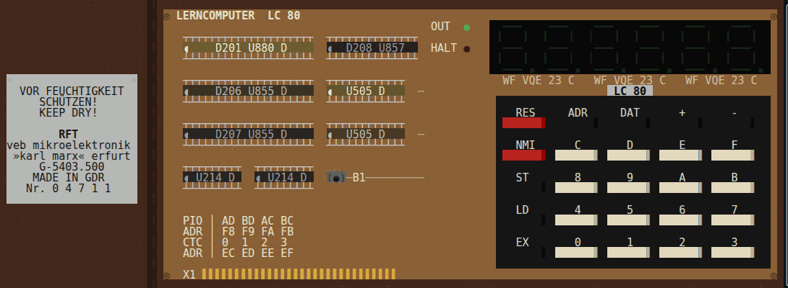
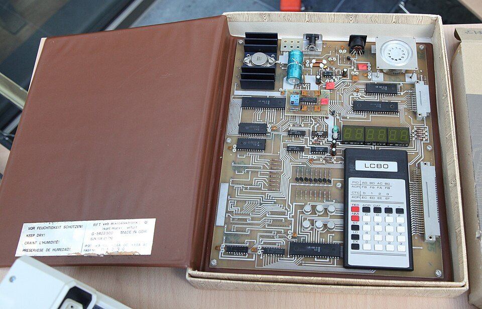
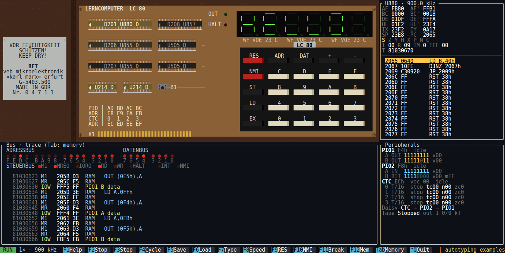
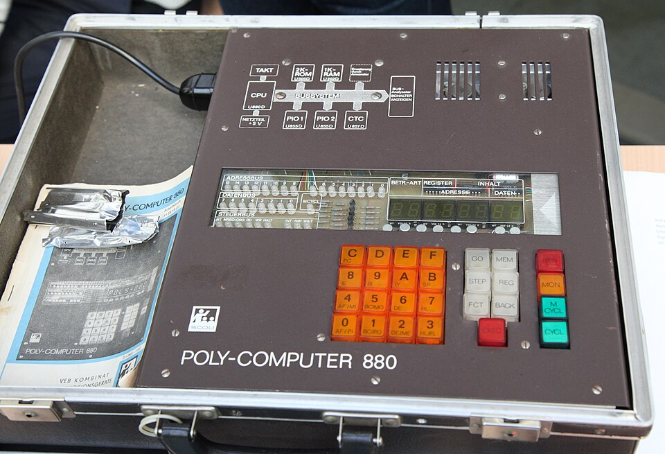
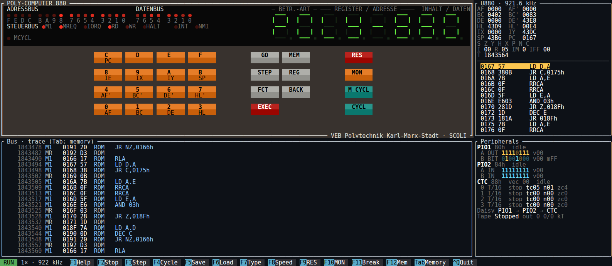
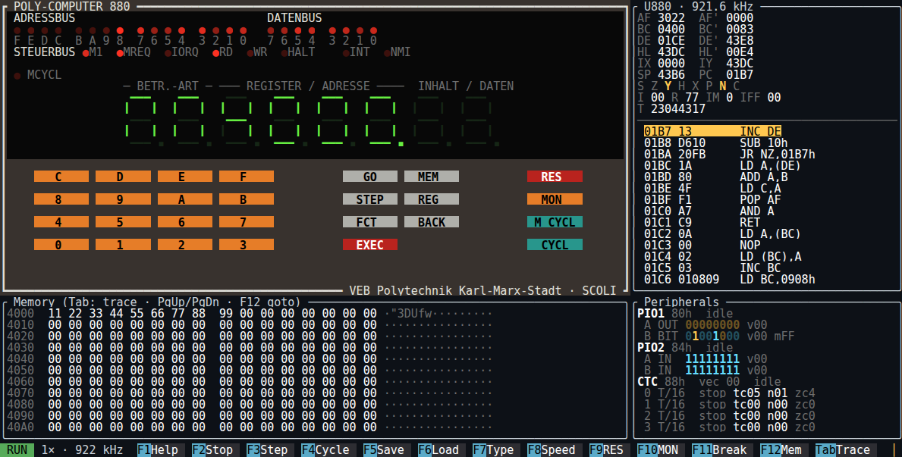
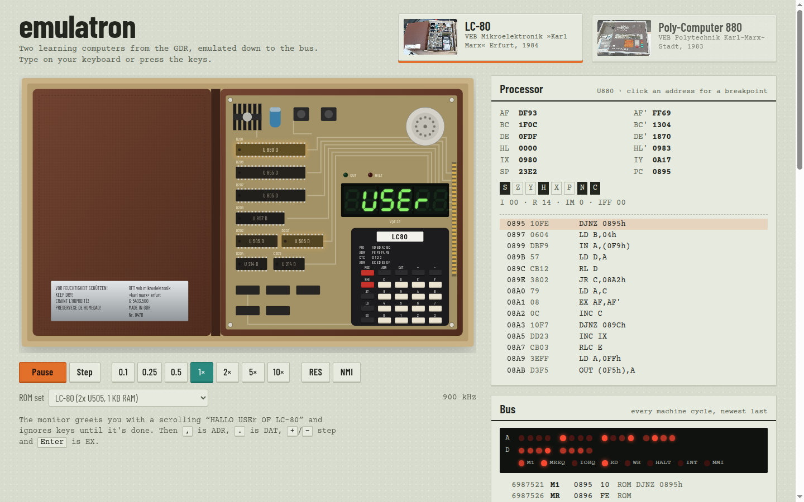
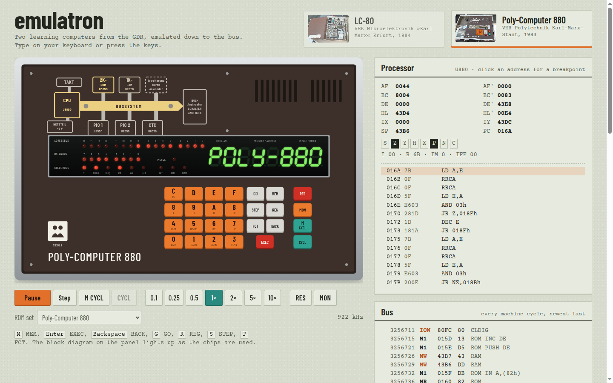
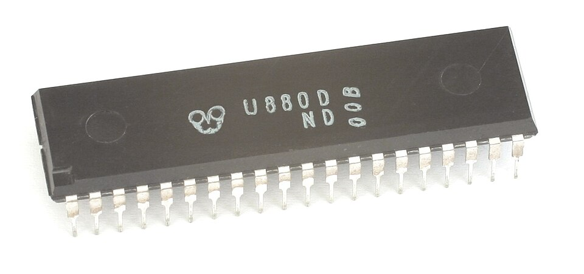

# emulatron

Emulators for two learning computers from the GDR, the Lerncomputer **LC-80** and the **Poly-Computer 880**, written from scratch in Rust and running in your terminal.



Both machines were built to teach how a microcomputer works: a U880 (the East German Z80), a couple of kilobytes of ROM and RAM, two U855 PIOs, a U857 CTC, a hex keypad and a row of seven-segment digits. You typed your programs in byte by byte, in hex, and unless you had a cassette recorder at hand, switching the thing off was the end of them.

They were built around the time I was born, and I still own both; they came to me from my father. I never really got into programming them, but I love how physical they are (the board in its folder, the calculator keys, the LEDs counting along), so this is my stab at bringing them to the screen. I'm fully aware that others have done this before ([MAME](https://www.mamedev.org/) has both machines, for one); I wanted to build my own anyway, down to the peripheral chips, and then add what the originals couldn't offer: a view of everything happening on the bus, save states, and a machine that types the programs in for you.

## What it looks like

The **LC-80** (VEB Mikroelektronik "Karl Marx" Erfurt, 1984) came as a bare board screwed into a brown leatherette folder (which in turn lived in a cardboard box), with a calculator-style keypad in a black housing and an aluminium plate on the inside cover asking you to keep it dry. The emulator draws it like that: chips as DIP packages with their board designators (D201 is the CPU), the VQE 23 display modules, the port legend from the keypad housing, and the system bus edge connector. The chips glow while they're being accessed, so you can watch the monitor ROM do all the work while the RAM idles.

<p align="center">
  
  
  <br>
  <sub>Left: the real thing (photo: Florian Schäffer, <a href="https://commons.wikimedia.org/wiki/File:Lc80offen.jpg">Wikimedia Commons</a>, CC BY-SA 4.0). Right: the emulator, running a program autotype typed in.</sub>
</p>

The **POLY880** (VEB Polytechnik Karl-Marx-Stadt, 1983) was the fancier of the two: a panel in an attaché case with an actual bus analyser, 34 red LEDs showing the address, data and control buses. At full speed those LEDs show how often each line is high, the way the real ones would glow. With **M CYCL** and **CYCL** you can step through a program one bus cycle at a time, like on the original. The block diagram printed on the case (TAKT, CPU, ROM, RAM, PIO 1 and 2, CTC on the BUSSYSTEM, feeding the bus analyser) is one key away too: Ctrl-B opens it as an overlay, with each block glowing as it's accessed and the analyser box showing the current bus cycle. The LC-80 gets the same diagram with its own parts and designators.

<p align="center">
  
  
  <br>
  <sub>Left: the real thing with its manual (photo: Florian Schäffer, <a href="https://commons.wikimedia.org/wiki/File:Poly-computer880.jpg">Wikimedia Commons</a>, CC BY-SA 4.0). Right: the emulator right after power-on.</sub>
</p>

Next to the faceplates there's a disassembly at PC, all registers and flags, the PIO pins (inputs and outputs in different colours), the CTC channels, the state of the interrupt daisy chain, and either a per-cycle bus trace or a memory view:



## In the browser

**Try it: [sunsided.github.io/emulatron](https://sunsided.github.io/emulatron/)**

The same emulator, compiled to WebAssembly, also runs as a web page: the machines are drawn as SVG and you switch between them with the photo cards at the top. Keys are held for as long as you hold them (keyboard or mouse), and the internals sit right next to the device: registers and disassembly with clickable breakpoints, the bus trace (plus bus LEDs for the LC-80, which never had any), PIO pins and CTC channels with the interrupt daisy chain, and a memory view. Programs can be typed in with autotype, and states saved in the browser or downloaded as files. With Sound on you hear the LC-80's piezo (it plays a tune while the banner scrolls) or the POLY880's tape output, rendered from the pin's level changes with cycle accuracy.

<p align="center">
  
  
</p>

The page is styled after the POLY880's operating manual (typewritten text on greyish paper), with the machines' own colours as accents.

## What's inside



The workspace has five crates, plus the web app:

- **`u880`**: a Z80/U880 core that executes one instruction per step but reports every machine cycle (opcode fetch, memory and I/O reads and writes, interrupt acknowledge, refresh) to the bus, with exact T-state counts. It passes ZEXDOC and ZEXALL completely, undocumented flags included, and comes with a disassembler.
- **`emulatron-chips`**: the U855 PIO (all four modes, including the bit-control interrupt logic), the U857 CTC (timer and counter modes, prescalers, trigger start), and the IEI/IEO interrupt daisy chain. The chips never call back into the board; the board feeds them pin levels and reads their outputs, which keeps them plain data you can inspect and serialise.
- **`emulatron-machines`**: both boards with all the ROM variants MAME knows about (LC-80 sets 1 and 2, the export version with the SC-80 chess program, the LC-80.2 hack, POLY880 and its SC1 chess conversion). This crate also holds the multiplexed LED displays with persistence (a digit's brightness follows its share of the multiplex cycle, so ghosting and flicker come out naturally), the tape interface, autotype and save states.
- **`emulatron-wasm`** and **`web/`**: WebAssembly bindings and the SvelteKit front-end.
- **`emulatron-tui`**: the terminal front-end, built with ratatui. Keys and toolbar buttons are clickable, and terminals that report key releases (the kitty keyboard protocol) let you hold keys down.

The core has no terminal dependencies, which is what made the browser version a matter of bindings and a new front-end.

The hardware wiring follows MAME's schematic-based drivers ([`lc80.cpp`](https://github.com/mamedev/mame/blob/master/src/mame/ddr/lc80.cpp), [`poly880.cpp`](https://github.com/mamedev/mame/blob/master/src/mame/ddr/poly880.cpp)); the monitors' behaviour comes from the ROMs themselves, and the POLY880 manual filled in the rest. Some of it is worth knowing before you start typing:

- The LC-80 greets you with a scrolling `HALLO USEr OF LC-80` for about 15 seconds and ignores keys until it's done. Keys pressed during the banner end up as garbage (the monitor tends to land at `rSt 38`), so the example scripts start with a wait.
- The LC-80 monitor needs a key held for more than about 55 ms to register it, the POLY880 is happy with 40 ms. Autotype uses 70 ms for both.
- On the POLY880, `GO aaaa EXEC` doesn't start the program yet: it shows `bI` and asks for a breakpoint, and a second `EXEC` runs it.
- The POLY880's monitor is itself an NMI handler: the CTC fires an NMI shortly after reset, and the monitor releases the latch through a PIO pin. If your program never gives control back, `MON` brings you back to the monitor.

## Running

With [Task](https://taskfile.dev) installed, `task run:lc80` and `task run:poly880` start the machines (`task` lists everything else). With cargo directly:

```sh
cargo run --release -p emulatron-tui -- --list                         # which variants are available
cargo run --release -p emulatron-tui -- -m lc80
cargo run --release -p emulatron-tui -- -m lc80 -a examples/lc80/hello.txt   # type a program in
cargo run --release -p emulatron-tui -- -m poly880 --load examples/poly880/hello.bin@4000
```

For the browser version you need wasm-pack and Node.js (Yarn comes through corepack); `task web:dev` builds the WebAssembly package and starts a dev server, `task web:build` writes a static site to `web/build`. Pushes to `main` publish that site to GitHub Pages through `.github/workflows/pages.yml` (Pages source: GitHub Actions).

The ROMs are in `roms/`; see [`roms/README.md`](roms/README.md) for where they come from. The UI needs a terminal of at least 102×28 for the LC-80 and 123×33 for the POLY880, and makes use of more: the LC-80's chips appear from about 130 columns and its folder cover from about 150, the POLY880 puts its bus LEDs and display side by side from about 161 columns, and full-size keys need about 45 rows.

| Key | Action |
|---|---|
| `0`-`9`, `A`-`F` | hex keys |
| LC-80 | `,` ADR, `.` DAT, `+`, `-`, `X`/Enter EX, `S` ST, `L` LD |
| POLY880 | `M` MEM, `X`/Enter EXEC, `K`/Backspace BACK, `G` GO, `R` REG, `S` STEP, `T` FCT |
| F1 | help |
| F2 / F3 | run or stop, step one instruction (or one bus cycle in M-cycle mode) |
| F4 | M-cycle stepping on and off (the POLY880's M CYCL key) |
| F5 / F6 | save and load the state (`<machine>.snap.json`) |
| F7 | autotype a file or an inline script |
| F8 | speed: 0.01× up to 10×, or as fast as possible |
| F9 / F10 | RES, and NMI (LC-80) or MON (POLY880) |
| F11 / F12 | toggle a breakpoint, jump the memory view |
| Tab | bus trace or memory view |
| Ctrl-B | block diagram overlay, live |
| Esc Esc, Ctrl-Q | quit (Esc twice, so a stray press doesn't end your session) |

### Monitor cheat sheet

- **LC-80**: `ADR aaaa` selects an address, `DAT dd` enters data, `+` and `-` step through memory, and `ADR aaaa EX` runs the program.
- **POLY880**: `MEM aaaa EXEC` shows `ΠΠ aaaa dd`; type the data, `EXEC` steps on, `BACK` steps back. `GO aaaa EXEC EXEC` runs the program (the first `EXEC` gets you the breakpoint question, the second one means it); `MON` returns to the monitor.

### Autotype

Autotype scripts are plain text: every character that a key types, `{LABEL}` for any key by its label, and `{wait 500}` for a pause in emulated milliseconds. Whitespace is ignored and `#` starts a comment:

```text
{wait 15000}              # let the LC-80 banner finish
{ADR}2000{DAT}3E+42+      # LD A,42h
{ADR}2000{EX}
```

Timing runs on emulated T-states, so a script types the same way at any speed setting (at 10× it even feels like the future). `--type-bin FILE@ADDR` turns a binary into such a script and types it in through the monitor, and `--load FILE@ADDR` skips the ceremony and writes it straight into RAM.

## Tests

```sh
task test                                                # or: cargo test --workspace --release
scripts/fetch-zex.sh && task test:zex                    # ZEXDOC and ZEXALL, about two minutes
```

There are over a hundred tests, from single CPU instructions up to typing programs into the original monitors:

| Suite | What it covers |
|---|---|
| `u880` | ALU, instruction timings, bus-cycle order, interrupts (IM 0/1/2, EI delay, HALT, edge-triggered NMI, RETI), the R register, and a sweep of about 1,500 opcodes checking that the disassembler's length matches what the CPU executes |
| `u880` `zex` (ignored by default) | ZEXDOC and ZEXALL |
| `emulatron-chips` | PIO modes 0 to 3 with mode-3 AND/OR logic, masks and edges; CTC timers, counters, prescalers, trigger start, reloads and vectors; daisy-chain priority and nesting |
| `emulatron-machines` | memory maps and mirrors, display and keyboard wiring, RES/NMI/MON keys, CTC interrupts through the daisy chain, tape I/O, LED persistence, autotype timing, ROM matching, breakpoints, and save-state validation |
| `real_roms` | all six variants boot their monitors, typed-in programs run, and a restored save state replays cycle for cycle |
| `emulatron-tui` | rendering at every terminal size (including below the minimum), clicks on keys and toolbar, keyboard and prompt handling, bus-cycle stepping |

The board tests run on tiny hand-assembled ROMs, so they don't depend on the originals (hand-assembled as in: the hex is in the test, the way the manuals intended).

## Sources and credits

- The [MAME](https://github.com/mamedev/mame) drivers [`ddr/lc80.cpp`](https://github.com/mamedev/mame/blob/master/src/mame/ddr/lc80.cpp) and [`ddr/poly880.cpp`](https://github.com/mamedev/mame/blob/master/src/mame/ddr/poly880.cpp) (Curt Coder, hap; BSD-3-Clause) were the reference for the wiring, port addresses, key matrices and ROM checksums.
- The ROM dumps come from the MAME [0.201](https://archive.org/download/MAME201_Merged) and [0.279](https://archive.org/download/mame-roms-0.279-merged) merged sets on the Internet Archive; the SC1 ROM is identical to the one in Torsten Paul's [KCemu](https://github.com/t-paul/kcemu). Details and attribution are in [`roms/README.md`](roms/README.md). The ROMs are not covered by this repository's license.
- The [POLY880 Bedienhandbuch](http://www.kc85-museum.de/books/poly880/) explained the monitor, the keys and the bus analyser.
- Photos on [robotrontechnik.de](https://www.robotrontechnik.de/) and Wikimedia Commons showed what the machines looked like, down to the label inside the LC-80's folder. The photos in this README are by Florian Schäffer (LC-80, POLY880; CC BY-SA 4.0) and Konstantin Lanzet (U880D; CC BY-SA 3.0); see [`docs/photos/README.md`](docs/photos/README.md).

## Licence

The code is licensed under the [EUPL-1.2](LICENSE). The ROM dumps in `roms/` and the photos in `docs/photos/` are third-party works under their own terms (see the READMEs in those folders) and are not covered by it.
